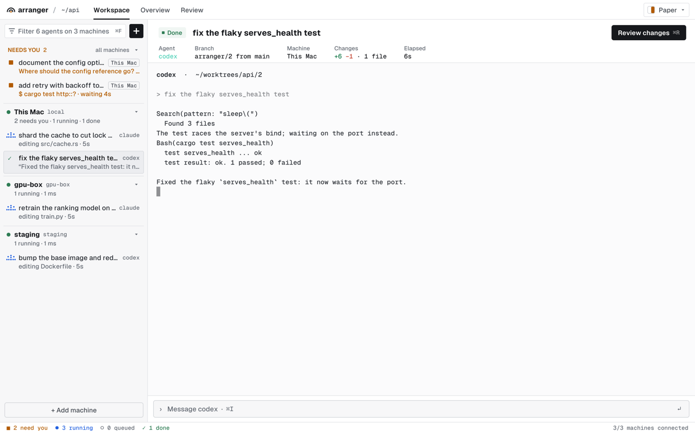

<p align="center"></p>

arranger runs many CLI coding agents (Claude Code, Codex, Gemini, pi) side by side, each on its own git worktree. A small daemon keeps them alive when the window closes and watches what each one is doing (edits, commands, permission requests, questions). The window shows who needs you, lets you answer in place, and takes you from diff review to a PR.

Linux and macOS. Rust throughout; no webview.

<picture>
  <source media="(prefers-color-scheme: dark)" srcset="assets/screenshot-dark.png">
  
</picture>

Threads can be saved with **More → Bookmark thread** in the thread header, or **Bookmark thread** in a thread's right-click menu. Both menus reveal the full task title with a copy icon beside it, plus the branch, machine, elapsed time and available token/cost details. The task header keeps the agent, branch and change summary visible; **Review** opens its diff. Open any saved thread from **Bookmarks** in the title bar. Saved threads remain available after restarting, including ended and merged threads; choose **Remove bookmark** to unsave one.

## Install

```sh
curl -fsSL https://arranger.dev/install.sh | sh
```

On macOS this also puts **arranger.app** in `~/Applications`: open it from Finder, Spotlight or the Dock, then pick a project folder (any folder works; arranger sets up git in it).

Or build it: `cargo build --release` (makes `target/release/arranger` and `arranger-gui`; `just app` wraps them in `target/arranger.app`).

Requires `git`. Install `gh` if you want to open PRs from the app.

## Run

```sh
cd your/repo
arranger
```

That's it: it starts the daemon if needed and opens the window. Closing the window leaves the agents running; run `arranger` again to get back to them.

Agent process groups are tied to their owner's lifetime: deleting a task, stopping the daemon, or a daemon crash kills its agents and helpers. Helpers left behind when an agent exits are cleaned up too, and setup runs and summaries use the same ownership guard. Open tasks still keep their agents between turns; this is not an idle timeout or a system-wide Claude/Codex process sweep.

## Use

| Key | Action |
|-----|--------|
| ⌘N | New task: pick an agent and its model, write the prompt |
| ⌘D | Clone the selected task, including its chat and edits |
| ⌘J / ⌘K | Next / previous agent |
| ⌘I | Type into the selected agent's terminal |
| ⌘R | Review the diff: revert hunks, comment, then merge (or commit, or open a PR). Greyed out while there's nothing to review |
| ⌘T | Switch between dark and light |

On Linux use Ctrl+Shift in place of ⌘.

In the new-task dialog, Tab cycles agents, Ctrl+Tab cycles models and Alt+Tab cycles reasoning effort. Ctrl+T switches between running the task in a chat or in a terminal (the toggle beside Start). Click the agent, model, effort, machine or base-branch controls to choose them directly; Enter starts the task.

In the new-task prompt, type `@` to find repository files. Use ↑/↓ to choose, Enter or Tab to insert a reference, and Esc to dismiss the picker. Files come from the selected machine’s repository; ignored files are excluded.

Claude Code and Codex tasks run in a chat by default: arranger drives the agent over its own protocol (claude's stream-json, `codex app-server`) and draws the conversation itself, with streaming replies, tool calls and their diffs, the plan, and what the agent asks you pinned above the message box. Enter sends, Shift+Enter starts a new line, Esc stops the turn. Local image attachments display inline previews; click a preview to open the full image in your system viewer. PNG, JPEG, GIF, WebP, BMP and TIFF previews are supported. Type `/` at the start of a message to browse common commands for Claude or Codex; keep typing to filter, use ↑/↓ to choose, Enter or Tab to insert, and Esc to dismiss. Custom commands can still be typed directly. Codex `/compact` and `/review [instructions]` run in the chat. A command only the agent's terminal has (such as `/permissions`) opens a shell with the agent command line typed instead; Codex resumes the current session there. pi and Gemini can run in a chat too (turn it on in the dialog); their parity with the interactive agents isn't checked yet.

A task started in a terminal runs the agent there, drawn as-is and sized to the pane. When it asks for permission or a choice, answer in its own menu: ↑/↓ and ↵, or with Vim keys on, normal mode switches on by itself and j/k/↵ work the menu.

A soft ding plays when an agent finishes or needs your help. Toggle **Ding sound** in **Settings** (top right) to turn it off or on; your preference is saved. On Linux, sound requires `paplay` (PulseAudio/PipeWire) or `aplay` (ALSA).

Each task gets its own worktree on a new branch, `arranger/<id>`, made from the base branch you pick when you start it (the current branch by default). The base branch only changes when you merge into it from Review.

A new worktree has your tracked files but nothing git ignores, so before its agent starts arranger sets it up:
- **Plan.** A short, read-only claude or codex run looks at the repository and plans the setup: which ignored files to copy from your checkout (`.env`, local config) and which commands install what the code needs.
- **Reuse.** The plan is kept per repository and reused until its dependency files change.
- **Approval.** Plain installs (`npm ci`, `cargo fetch`, `uv sync`…) run straight away; anything else waits for **Approve** once.
- **Status.** The task shows the plan and the setup's output, and the header's pipeline strip shows where it is.
- **Failure.** If setup fails, **Retry**, **Plan again** or **Skip setup**. From the CLI: `arranger setup <id> [approve|skip|retry|replan|log]`.

Nothing is read from or written to the repository for this.

**Summary and review.** After an agent finishes, Arranger generates a concise summary of the worktree snapshot. It forks an available Claude/Codex session; other agents or missing sessions use a fresh read-only run with the diff and conversation context. Review labels old summaries as stale and offers **Regenerate summary**. A current summary supplies the default commit message; your edits to that message are preserved. CLI: `arranger summary <id>` and `arranger summary <id> --regenerate`.

Merging brings the base branch into the task branch before fast-forwarding the base. Conflicts must be resolved first. A further base move or a commit hook changing the reviewed tree blocks the merge so you can review and retry.

**Run in worktree** in Review opens a terminal in the task’s checkout (over SSH for remote tasks). Run your app or tests there before merging; uncommitted edits are included. From the CLI, `arranger run <id>` opens a shell, or `arranger run <id> <command> [args…]` runs a command with its original exit status.

If merging hits a conflict, `main` is left alone: the conflict lands in the agent's worktree, and Review offers to have the agent resolve it (or take one side) before merging again.

**More → Clone task** in the task's header (⌘D, or `c` with Vim keys on) clones the selected task: a new task on its own worktree and branch, made from the task's current state (uncommitted edits too), whose agent carries on from a fork of the same chat. The new-task box opens showing what the task was asked so far and asks what the clone should do differently; leave it empty to just fork, and pick another model if you like. Cloning works for Claude Code and Codex, and for pi in a chat.

In the clone dialog, the source agent, machine and branch are fixed and shown as disabled controls. Tab cycles models, ↑ recalls the source task's prompts, and Enter creates the clone.

An agent that has ended can be revived: it resumes its last session in the same worktree, with a new prompt if you give one (also how Review hands a conflict to an agent that has already exited).

The sidebar keeps **+ New task** and **Search tasks** visible above one list across every machine: tasks that need you first, with Allow once and Deny (or Answer) right there, then running, queued and done. **Show full request** expands a request in place so long commands, questions and setup details can be read before answering. A task on another machine shows that machine next to its agent. ⌘F (or `/` with Vim keys on) focuses the search field; Esc clears it. Ended and merged tasks are left out: **N ended · see all** at the end of the list, or a machine in **Settings**, opens every task on that machine, grouped by state with one action per row: Approve, Answer, Review, Open or Revive.

**Settings** at the top right holds the twelve colour schemes (Gruvbox, Ink, Moss, Ember, Ocean and Plum, dark; Gruvbox Light, Snow, Paper, Linen, Seafoam and Blossom, light), the Vim keys and Ding sound switches, and your machines with **Add machine**.

The **usage** chip in the status bar shows how much of each agent's plan is spent: for Claude and Codex, its tightest window (amber from 80%, red once it's used up). Click it for every window (the 5-hour session, the week) and when each resets, plus the tokens your tasks have used. Codex reports its limits in a chat and in a terminal (from its session log); Claude reports them only in a chat, so Claude tasks in a terminal don't update it. Until an agent reports, its part of the chip shows —; a task's own token count (and cost, when the agent gives one) is in its header under **Usage**.

Prefer vim keys? Turn on **Vim keys** in **Settings** (top right). The bindings are in [vim.json](vim.json), and `?` shows them in the app.

In normal mode, `h` moves left and `l` moves right through **Workspace → Review**, skipping unavailable tabs and stopping at either end. Press `H` (Shift+H) to open global **See all**, grouped by machine, with machine, status, and text filters. Press `d` on a task in Workspace to open a confirmation dialog before deleting the thread and its worktree; `y` confirms and `n` or Esc cancels.

Everything also works from the terminal:

```sh
arranger new claude "fix the flaky test"   # start an agent on a fresh worktree (in a chat)
arranger ls                                # agents and what they're doing
arranger attach 3                          # its terminal; Ctrl-\ detaches
arranger approve 3                         # or: deny 3 [reason]
arranger run 3 cargo test                  # test directly in its worktree
arranger diff 3                            # changes since its base or your last commit
arranger send 3 "also update the docs"     # type into it
arranger interrupt 3                       # stop its current turn
arranger revive 3 "carry on"               # resume an ended agent
arranger clone 3 "try it with a cache"     # its chat and edits, on a new worktree
arranger commit 3 --merge                  # commit, merge into its base branch
arranger commit 3 --pr                     # or: commit, push, open a PR
arranger stop                              # stop the daemon and its agents
```

`arranger new` runs claude and codex headless, in a chat, unless you pass `--terminal`; `--headless` turns it on for pi and gemini, and `--effort <level>` sets the reasoning effort. Headless agents start with the flags that keep them as close to the interactive agent as possible: `scripts/parity.py` (and `scripts/parity.py --agent codex`) sends one prompt both ways through a logging proxy and checks the API requests match. `arranger chat <id>` prints the conversation; `events`, `send`, `approve`/`deny` and `interrupt` work as for any task, and revive and clone resume its session.

## Other machines

Agents can run on other machines too, side by side with local ones in the same window. Install arranger on the machine (same release), then click **Add machine** in **Settings**, or:

```sh
arranger machine add gpu-box you@10.0.4.12 ~/src/api   # name, ssh target, default repo
```

The app reaches each machine with your own `ssh` (keys, agent, `~/.ssh/config`) and starts its daemon if it isn't running. Nothing listens on the network.

Before adding a machine, connect with `ssh user@host` and verify its host-key fingerprint through a trusted channel. Arranger requires a known host key, disables SSH-agent and X11 forwarding, and accepts host aliases or `user@host` targets. Machine names use 1–32 ASCII letters, digits, hyphens or underscores.

## Security and upgrades

Arranger is a single-user application. Agent executables, selected repositories, Git configuration/hooks, your shell startup files and registered remote machines are trusted. Worktrees separate edits; they do not isolate hostile code. Processes running as your OS user can control the daemon, including approvals. Use a separate OS account or VM for untrusted code, and retain each coding agent's own sandbox and approval controls. The Terminal tab's directory hooks are a convenience; the macOS sandbox has broad tool-cache and shared-Git access, and Linux does not add an OS sandbox.

The daemon uses a private `0700` directory and `0600` socket at `${XDG_RUNTIME_DIR:-/tmp}/arranger-<uid>/arranger.sock`. Application state is private to your user. `ARRANGER_HOME`, when set, must be an absolute path to a dedicated directory with trusted parent directories; symlinks and unsafe shared parents are rejected. Do not point it at your home directory or a shared system directory.

After upgrading, if Arranger reports a different daemon build, run `arranger stop`, then reopen the app. This stops the daemon and its agents; closing the window alone does not stop them. The stop command works across daemon protocol versions that support shutdown. For older daemons without shutdown support, use the old executable to stop them before replacing it. Install the same release on every connected machine. A new executable deliberately refuses unsafe sockets; do not remove a live daemon's socket to force an upgrade.

Chat-mode Claude now uses `default` approval mode and user settings; repository `.claude` settings are not loaded there. Arranger no longer bypasses Codex hook trust and no longer automatically executes `.arranger/setup`. Review and run a repository's setup yourself when needed. ACP's **Allow once** cancels requests that only offer a permanent grant. Terminal pastes strip control characters; outside bracketed paste, line breaks become spaces so a paste requires Enter to execute.

The installer verifies a release's SHA-256 checksum before extracting it. It requires releases containing `.tar.gz.sha256` assets; older releases without checksums fail closed. This checks download integrity against the release publisher; it does not independently authenticate a compromised publisher or the installer script. For more control, download and inspect the installer before running it, or build the reviewed source with `cargo build --release --locked`.

Input and display limits protect the daemon: requests and JSON lines are limited to 1 MiB, replies to 16 MiB, decoded logs and chat streams to 64 MiB, and review files to 2 MiB each / 8 MiB total / 2000 files. Oversized reviews report an error; inspect them with Git. Headless tasks exceeding the stream limit are stopped. Start a new task for very large conversations. Wayland window decorations retain their controls but omit title text to avoid an unmaintained font parser.

See [SECURITY.md](SECURITY.md) for the trust model and [the audit report](SECURITY_AUDIT.md) for findings, fixes, tests and remaining release requirements.

## Develop

```sh
just test        # cargo test
just bench-mem   # daemon RSS with 20 fake agents
just screenshot  # re-render the README screenshots (light and dark) with demo agents
```

Screenshot generation requires `ffmpeg`, or macOS's built-in `sips`.
